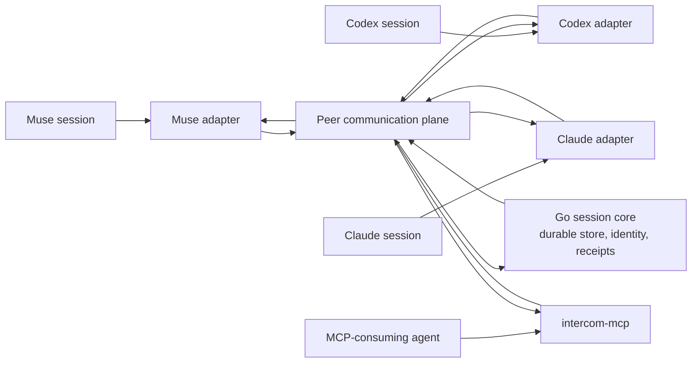

# Intercom

Intercom is an agent-agnostic communication protocol for independently running agents. It lets sessions discover peers, address them directly, exchange messages, and receive delivery receipts without a central orchestrator and without surrendering their own execution authority, context, or permission boundaries.

Messaging is durable: commands are admitted once, deduplicated, journaled, and replayable after a crash. The same core works across harnesses through adapters, so a Muse session can coordinate with a Codex or Claude session without either one adopting the other's runtime. Intercom implements [ICSP-001](docs/spec/ICSP-001.md), the protocol design draft in this repository. It is a distinct communication and coordination layer; it is not a replacement for ACP, and it includes ACP interoperability.

**Status: experimental.** Core profiles are implemented with automated conformance evidence; live qualification is limited to the harnesses and paths recorded below. Not approved for general production use.

## Contents

- [What it gives you](#what-it-gives-you)
- [How it works](#how-it-works)
- [Requirements](#requirements)
- [Quick start](#quick-start)
- [Harness interoperability](#harness-interoperability)
- [Configuration and integration](#configuration-and-integration)
- [Security and trust boundaries](#security-and-trust-boundaries)
- [Implementation and qualification status](#implementation-and-qualification-status)
- [Known limitations](#known-limitations)
- [Testing and verification](#testing-and-verification)
- [Deeper documentation](#deeper-documentation)
- [Contributing](#contributing)
- [License](#license)
- [Disclaimer](#disclaimer)

## What it gives you

| Capability | What it provides |
|---|---|
| Peer discovery | Enumerate visible sessions and resolve aliases or session IDs to identities |
| Direct messaging | Address a named session, with replies and correlation IDs |
| Delivery receipts | Distinguish presented, delivered, injected, and rejected outcomes |
| Durable messaging | Single-admission commands, event replay, state projection, crash recovery |
| Cross-harness interop | Adapters for Muse, Codex, OpenCode, Hermes, Claude Code, and MCP consumers |
| Authority preservation | Peers coordinate; they do not inherit another peer's permissions or approval rights |

The problem it solves: agents in different harnesses normally cannot see or address one another. The usual workaround is a central orchestrator that owns everyone's state and authority. Intercom supplies a small communication plane instead, so coordination does not require giving up control of a session.

## How it works

Three layers, as the specification defines them:

1. **Session core.** Durable command intake and settlement, an event journal, state projection, and recovery classification. Harness-independent.
2. **Peer communication plane.** Discovery, direct addressing, delivery, wake, receipts, and access control. Works with no orchestrator.
3. **Harness interoperability layer.** Adapters that translate a harness's native surface into the Intercom contract.

The Go core owns durability, identity, authorization, and delivery truth. It is the only component that writes the store. Python adapters own harness quirks and never write durable state; they deliver into a harness and report receipts back.



An adapter claims only the delivery modes its harness genuinely supports. Unsupported behavior is never silently simulated with a semantically different operation: a steer request to a queue-only recipient is refused, downgraded with a reported downgrade, or delivered as notification only according to an explicit policy. It is never quietly turned into a new prompt.

## Requirements

- Go 1.25 or newer. The build host's module cache must contain `github.com/google/uuid`, `golang.org/x/sys`, and `modernc.org/sqlite`. The Go build needs no network access when the cache is populated.
- Python 3 for the adapter host. Its own protocol client has no third-party dependencies; adapters that need ACP use the `acp` package only where the harness requires it.
- A Unix host for `SO_PEERCRED` peer identity and the local Unix socket transport.

## Quick start

```sh
go build ./...
go test ./...
cd adapters/python && python3 -m unittest discover -s tests
```

Start a host, then use the CLI as a peer:

```sh
go run ./cmd/intercomd --socket /tmp/intercom/intercom.sock --alias my-host

go run ./cmd/intercom --socket /tmp/intercom/intercom.sock hello
go run ./cmd/intercom --socket /tmp/intercom/intercom.sock peers
go run ./cmd/intercom --socket /tmp/intercom/intercom.sock capabilities <session>
go run ./cmd/intercom --socket /tmp/intercom/intercom.sock send <session> "hello" --mode notify
go run ./cmd/intercom --socket /tmp/intercom/intercom.sock status <message>
```

`hello` negotiates protocol features and capabilities; `peers` lists visible sessions; `capabilities` reads a peer's declared delivery modes. `send` accepts `--mode steer|queue|notify`, `--wake none|if_idle|next_safe_point`, `--on-unsupported reject|downgrade|notify`, `--command-id`, `--reply-to`, `--correlation-id`, and `--ttl`. `status` reads delivery receipts. The CLI is a peer, not an operator tool: it has no path to the durable store and no special authority.

### Two registered sessions

The daemon binds session identity per connection through `session/register`, not as a daemon-wide flag. A two-party exchange uses two participants registered on the same daemon. The repository's zero-spend demo starts a Muse participant and two scripted MCP participants; the same shape works with two MCP participants:

```sh
go run ./cmd/intercom-mcp --socket /tmp/intercom/intercom.sock \
  --session ses_scripteda000000000000000001 --alias agent-a --harness mcp-scripted
go run ./cmd/intercom-mcp --socket /tmp/intercom/intercom.sock \
  --session ses_scriptedb000000000000000001 --alias agent-b --harness mcp-scripted
```

Drive each participant with an MCP client: from A call `peers_list`, then `message_send {to: <ses_b>, text: "hello", mode: "queue"}`. From B call `inbox_list`, then `message_ack` with `presented` followed by `handled`, and `message_reply`. A can then read `message_status`. `message_ack` with `handled` is what asserts the agent acted; `presented` only means the inbox claim succeeded. `injected` is refused on the MCP path by design. See [the end-to-end demo](docs/DEMO.md) for the full zero-spend sequence and expected receipt transitions.

### ACP over stdio

```sh
go run ./cmd/intercom-acp --socket /tmp/intercom/intercom.sock --session ses_x --harness muse
```

`intercom-acp` is a thin forwarder: it connects to `intercomd` over the daemon socket, registers its session on that connection, and forwards every stdio request. It never opens the durable store. The binary is also an ordinary ACP agent for a client that knows nothing about Intercom; standard methods keep their own semantics and the extension is advertised only through `_meta`. The extension namespace is `dev.bamn.intercom`.

## Harness interoperability

Rows below describe what the adapter declares and what evidence exists. Adapter code is not the same as live verification.

| Integration | Discovery | Messaging | Notify | Queue | Active-turn steer | Live evidence |
|---|---|---|---|---|---|---|
| Muse (MSP) | native | native | native (`presented`) | native (`turn/start`, ifBusy=queue) | **native and live-verified** | Echo provider: steer 5/5 accepted during running turns; queue delivered |
| Codex (app-server) | native | native | native | native (`turn/start`) | **native and live-verified** | One authorized turn: steer changed the running turn's output |
| OpenCode (ACP) | native | native | native | native (`session/prompt`) | unsupported | One local-provider turn: queue delivered as next turn |
| Hermes (ACP) | native | native | native | native | unsupported | Shares the ACP client; reference-ACP conformance test passes. No separate live harness run recorded |
| Claude Code (stream-json) | native | native | native | native (next-turn input) | unsupported | Live MCP participation with an explicit `mcp__intercom__peers_list` grant |
| MCP consumers (`intercom-mcp`) | native | native | native | native (durable inbox claim) | unsupported | Scripted A to B claim/present/handle/reply; Go phase-7 tests |

Muse and Codex steer because MSP and Codex app-server expose a `turn/steer` with an expected active-turn ID that fails when the turn is gone. ACP harnesses and Claude Code have no active-turn injection point; a newly submitted prompt is queueing, not steering, and is reported as unsupported with a limitation. MCP queueing is a next-turn channel, so MCP-only participants cannot steer and wake only while an adapter is connected.

## Configuration and integration

Daemon options: `--config`, `--socket`, `--data-dir`, `--alias`, `--harness`, `--principal`, `--host`, `--remote-listen`, `--json`, `--version`. `--session` and `--remote-token` are deprecated; sessions are bound per connection and remote identity is file-based. `INTERCOM_SOCKET` supplies the default CLI socket. `intercom-mcp` adds `--session`, `--session-secret-file`, `--attach`, and `--delegation-token-file`.

Per harness, the adapter host is selected with `--harness muse|codex|opencode|hermes|claude`. Muse uses `--muse-bin` and `--muse-provider echo` for a zero-spend echo run. Codex uses `--codex-bin codex` and an optional `--codex-home` pointing at a profile, without editing global config. Claude requires `--claude-budget-usd` and, for MCP tools, an explicit `--claude-allowed-tools mcp__intercom__peers_list` grant. See [harness evidence](docs/HARNESSES.md) and [the demo](docs/DEMO.md).

## Security and trust boundaries

- The daemon principal is the local Unix user. All local clients sharing that user are one principal; they are **not** strongly isolated agent principals. Per-agent isolation would need separate credentials, which the daemon does not mint.
- Remote sender identity is host-qualified as `hostId/sessionId`, and grants are checked against that qualified ID on the receiving host.
- The capability matrix is enforced by the adapter contract: an adapter cannot advertise a capability it did not declare with a limitation.
- Peer authority never includes approval authority. `approval.owner_control` is advertised and the separation is enforced, but the approval request itself belongs to the harness's permission mechanism.
- Receipts are facts reported by adapters, never invented by the core. `presented` is not `injected`; `handled` requires an explicit acknowledgement.
- `IC-REMOTE` accepts only mTLS with pinned host fingerprints and mutual enrollment. Plaintext remote transport is impossible.

## Implementation and qualification status

Three distinct levels are reported separately: **implemented** (code exists), **tested** (automated tests exercise the real path), and **live-qualified** (observed against the real harness binary).

| Profile | Implemented | Automated tests | Live qualification |
|---|---|---|---|
| `IC-LOCAL` | yes | conformance protocol tests | Local CLI and MCP peer exchange demonstrated |
| `IC-DURABLE` | yes | crash, replay, dedup conformance tests | In-process acceptance with real processes and client connections |
| `IC-ACP` | yes | ACP conformance plus reference ACP client test | Reference client exercised against the Go extension |
| `IC-REMOTE` | yes | two-host mTLS exchange in-process | Non-loopback live exchange with real harnesses not qualified |
| `IC-STEER` | Muse, Codex | adapter contract tests | Muse echo 5/5; Codex one turn changed output |

## Known limitations

- Cross-host exchange with real harnesses is not yet live-qualified; `IC-REMOTE` is loopback-qualified only and opt-in with `--remote-listen`.
- Steering is harness-dependent. Only Muse and Codex have verified native active-turn steering; ACP and Claude harnesses report unsupported.
- Tool-level approvals remain owned by the individual harness. Intercom enforces the boundary but does not provide the approval UI.
- Journal retention is currently time-based; sequence-based compaction would need per-session event counts.
- Local clients under one Unix user share a principal; strong per-agent isolation is not provided.
- Provider-side failures are not Intercom failures: some model catalogs do not register MCP tools for their models, and wrapper binaries may lack an app-server mode. These are recorded in the harness evidence.

## Testing and verification

```sh
go test ./...
cd adapters/python && python3 -m unittest discover -s tests
scripts/qualify.sh          # suites plus live no-spend protocol checks
scripts/qualify.sh --quick  # suites only
```

`conformance/` holds the section 14 protocol tests and section 16 acceptance criteria, numbered to match the specification. Acceptance tests spawn real processes and real client connections rather than using in-process shortcuts. `adapters/python/tests/` holds adapter honesty rules, MSP mapping, and the steer-refusal rule. `internal/` covers the store, protocol, and transport.

## Deeper documentation

- [Architecture](docs/ARCHITECTURE.md) - layers, authority boundary, durability model, delivery semantics
- [Capability matrix](docs/CAPABILITIES.md) - native versus emulated versus unsupported, qualification levels
- [Harness integration evidence](docs/HARNESSES.md) - live wire contracts and recorded runs
- [Surface Bridge](docs/SURFACE.md) - delegated presentation scope and receipt truth
- [End-to-end demo](docs/DEMO.md) - repeatable zero-spend walkthrough
- [ICSP-001 specification](docs/spec/ICSP-001.md) - protocol design draft

## Contributing

Issues and focused pull requests are welcome. Protocol changes should include the matching numbered conformance test and an honest statement of which qualification level the evidence supports.

## License

MIT. See [LICENSE](LICENSE).

## Disclaimer

This project is an independent, experimental work by the repository author. It is not affiliated with, directed, endorsed, or approved by FreeInference.org ("FI"). FI has no involvement in this project's design, development, or publication, and bears no responsibility for it. Every decision to create, modify, and publish this work was made by me, at my own discretion.

If you find this project useful or helpful, please consider sponsoring or otherwise supporting FreeInference.org. FI provides a useful and valuable service to people who might not otherwise have the opportunity to access this kind of tooling.
